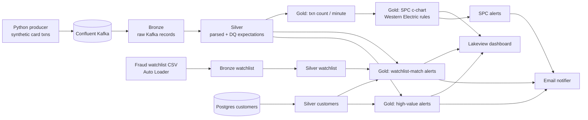
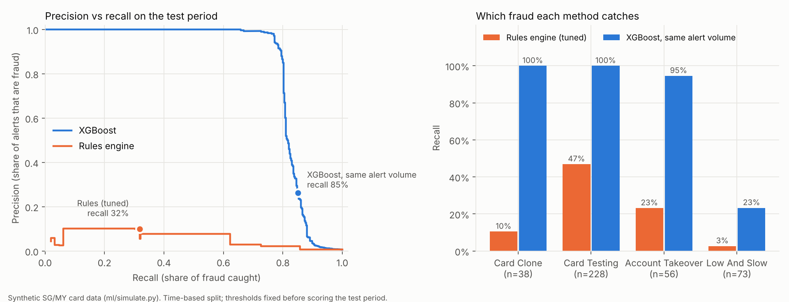

# FinGuard Streaming+ — Real-Time Card Fraud & Transaction Monitoring


Streaming fraud detection on **Kafka → Databricks (Lakeflow Declarative Pipelines) → Delta → Dashboard + email alerts**, extended with **Statistical Process Control (SPC)** to catch *pattern-level* anomalies that per-transaction rules miss.

> **Credit:** Built on top of [databeli/finguard_streaming_project](https://github.com/databeli/finguard_streaming_project) by Narender Kumar (Kafka producer, bronze/silver ingestion, rule-based alerts, Lakeview dashboard).
> **My contributions** are listed below and in the commit history.

---

## The business problem

| | Current state (rules only) | Future state (rules + SPC + ML) |
|---|---|---|
| What gets caught | Single transactions that break a fixed rule (over limit, on watchlist) | Also volume spikes (card-testing bots), silent outages, and gradual drifts |
| Thresholds | Hard-coded, one size fits all | Self-adjusting control limits from the last 60 minutes |
| Analyst workload | Every rule hit is an alert | Alerts ranked by severity (SPIKE / DROP / SHIFT) |
| Fraud caught (same alert volume)* | 32% | **85%** |
| Share of alerts that are real fraud* | 10% | **26%** |
| Fraud value caught* | 47% | **91%** |
| Alert latency | _TBD: measure on a live run_ | _TBD_ |

\* Measured on a held-out test period of synthetic data. See [XGBoost vs rules](#2-xgboost-fraud-score-vs-the-rules-engine-ml) for the method and caveats.

## Architecture



## My contributions

### 1. SPC monitoring of transaction volume (`gold/transaction_volume_spc.py`)
I applied the control-chart methods I used for 16 years in semiconductor process monitoring to a payments stream.

- **c-chart** (Poisson count data): limits = c̄ ± 3√c̄ from a rolling 60-minute baseline. The baseline excludes the current point, so a spike can't hide itself by inflating its own limits.
- **Western Electric rules WE1–WE4**: catch spikes and drops, and also small sustained shifts that never cross a fixed threshold.
- **Silent minutes are filled with 0**, so an upstream outage shows up as a `DROP` alert instead of disappearing from the data.
- Output: `finguard.gold.transaction_volume_spc` (full chart) and `..._spc_alerts` (out-of-control minutes only), with status `IN_CONTROL / SPIKE / DROP / SHIFT / WARMING_UP`.
- Tunable through pipeline config: `finguard.spc.baseline_minutes`, `finguard.spc.min_baseline_points`.
- **Unit tested locally** with PySpark (`tests/test_spc.py`): warm-up, false-alarm rate on stable data, spike, outage, and a +1σ shift caught by WE3/WE4 but not WE1.

### 2. XGBoost fraud score vs the rules engine (`ml/`)
**Question:** at the same analyst workload, how much more fraud does a model catch than the existing rules?

**Why a new simulator.** The streaming producer scores transactions *with the rules engine itself*, and its "forced fraud" flag changes only the label, not the transaction. Any model comparison on that data is circular. So `ml/simulate.py` generates a labelled Singapore/Malaysia card portfolio (218k transactions, 3,000 customers, 28 days, SGD) where fraud is injected as **behaviour**:

| Scenario | What happens |
|---|---|
| Card testing | Burst of SGD 1–15 online charges, often followed by a cash-out purchase |
| Account takeover | High-value electronics/jewellery/crypto, often at night; 30% via remote-access malware on the victim's **own phone** |
| Card clone | Card swiped abroad minutes after a genuine home purchase (no device signal) |
| Low-and-slow | Normal-looking amounts at normal merchants over days; 50% on the victim's own phone |

Legitimate noise is deliberate: Johor–Singapore cross-border shoppers, holidays abroad, new phones, occasional big purchases, gamers at high-risk merchants.

**Fair comparison**
- The rules engine uses the **original weights** from `fraud_engine.py`, ported to event time. Thresholds were converted from INR, and the hard-coded Delhi→London check was generalised to "different country within 20 minutes" (see `ml/features.py`).
- Rules threshold **tuned for best F1** on the training period, so the baseline is the rules at their best.
- **Time-based split:** train on days 1–16, choose thresholds on days 17–20, score once on the untouched days 21–28 (62k transactions, 395 fraud).
- Model features use only each customer's **earlier** transactions. A test checks that no score changes when future data is removed.

**Results (test period)**

| | Rules (as designed, ≥50) | Rules (tuned) | XGBoost, same alert volume | XGBoost, best F1 |
|---|---|---|---|---|
| Fraud caught (recall) | 32% | 32% | **85%** | 78% |
| Alerts that are fraud (precision) | 5% | 10% | 26% | **93%** |
| Alerts per 10k transactions | 375 | 202 | 207 | **54** |
| Fraud value caught | 48% | 47% | **91%** | 86% |
| Analyst hours (8 days, 5 min/alert)† | 194 | 105 | 107 | **28** |
| PR-AUC | 0.06 | 0.06 | 0.83 | 0.83 |

† 5 minutes per alert is an assumption. Replace it with your team's figure.

Two ways to use the model:
- **Same workload, more fraud caught:** recall goes from 32% to 85%, and the share of fraud value stopped from 47% to 91%.
- **Same coverage, less workload:** at its best-F1 point, the model raises **74% fewer alerts** than the tuned rules (54 vs 202 per 10k) while catching 78% of fraud instead of 32%.



**Where each method wins.** The rules miss card clones because "impossible travel" only fires within 20 minutes. The model uses travel *speed*, so it catches them. Low-and-slow fraud stays hard for both (23% vs 3%). That's the honest next frontier, and it's where customer-behaviour profiling would help.

**Robustness.** The result holds across 4 simulation seeds: the model catches 85–93% vs 32–55% for the rules at the same alert volume ([`ml/results/seed_check.md`](ml/results/seed_check.md)).

**Caveats.** This is synthetic data that I designed, so the fraud patterns are cleaner than real life and the size of the gain on real bank data would be smaller. What transfers is the **method**: a behaviour-based simulator, a leak-free event-time feature pipeline, a tuned-rules baseline, and comparison at a matched alert budget.

Reproduce: `pip install -r ml/requirements.txt && python ml/train_compare.py` (about 20 seconds).

### 3. Security clean-up
- Removed a hard-coded Kafka API secret and personal email addresses, and scrubbed them from git history.
- `.env` is no longer committed; `.env.example` provided; alert recipient comes from `ALERT_EMAIL`.

### 4. CI
- GitHub Actions runs the test suite on every push: SPC rules, simulator determinism, a no-future-leakage check, and model-beats-rules on a held-out period.

## Roadmap
- [x] XGBoost fraud score, compared on precision/recall against the rules engine
- [ ] Serve the model in the streaming gold layer (MLflow model + `ai_query`/UDF scoring)
- [ ] Distance-based "impossible travel" (haversine + max speed) to replace the hard-coded city pair
- [ ] SGD/MYR currency and per-customer thresholds for an SG/MY setting
- [ ] Quarantine table for rows dropped by data-quality expectations + daily DQ pass rate
- [ ] SPC p-chart on alert rate (alerts ÷ transactions)

## Run it

```bash
# Producer
cd kafka_producer
cp .env.example .env        # fill in Confluent credentials
pip install -r requirements.txt
python producer_normal.py

# Tests (no Databricks needed)
pip install pyspark pytest numpy
pytest -q tests/
```

In Databricks: store Kafka credentials in secret scope `finguard-scope` (see `02_Setup_Secret_Scope.py`), then add the `finguard_streaming/` folder as the source of a Lakeflow Declarative Pipeline.
