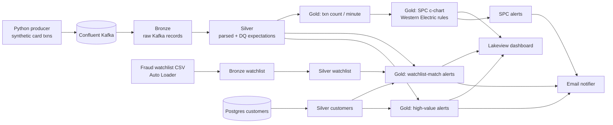

# FinGuard Streaming+ — Real-Time Card Fraud & Transaction Monitoring


Streaming fraud detection on **Kafka → Databricks (Lakeflow Declarative Pipelines) → Delta → Dashboard + email alerts**, extended with **Statistical Process Control (SPC)** to catch *pattern-level* anomalies that per-transaction rules miss.

> **Credit:** Built on top of [databeli/finguard_streaming_project](https://github.com/databeli/finguard_streaming_project) by Narender Kumar (Kafka producer, bronze/silver ingestion, rule-based alerts, Lakeview dashboard).
> **My contributions** are listed below and in the commit history.

---

## The business problem

| | Current state (rules only) | Future state (rules + SPC + ML) |
|---|---|---|
| What gets caught | Single transactions that break a fixed rule (over limit, on watchlist) | Also volume spikes (card-testing bots), silent outages, and gradual drifts |
| Thresholds | Hard-coded, one size fits all | Self-adjusting control limits from the last 60 minutes |
| Analyst workload | Every rule hit is an alert | Alerts ranked by severity (SPIKE / DROP / SHIFT) |
| Alert latency | _TBD: measure_ | _TBD: measure_ |
| False-positive rate | _TBD: measure_ | _TBD: measure_ |

> Fill in the TBD cells from real pipeline runs. Measured numbers only.

## Architecture



## My contributions

### 1. SPC monitoring of transaction volume (`gold/transaction_volume_spc.py`)
I applied the control-chart methods I used for 16 years in semiconductor process monitoring to a payments stream.

- **c-chart** (Poisson count data): limits = c̄ ± 3√c̄ from a rolling 60-minute baseline. The baseline excludes the current point, so a spike can't hide itself by inflating its own limits.
- **Western Electric rules WE1–WE4**: catch spikes and drops, and also small sustained shifts that never cross a fixed threshold.
- **Silent minutes are filled with 0**, so an upstream outage shows up as a `DROP` alert instead of disappearing from the data.
- Output: `finguard.gold.transaction_volume_spc` (full chart) and `..._spc_alerts` (out-of-control minutes only), with status `IN_CONTROL / SPIKE / DROP / SHIFT / WARMING_UP`.
- Tunable through pipeline config: `finguard.spc.baseline_minutes`, `finguard.spc.min_baseline_points`.
- **Unit tested locally** with PySpark (`tests/test_spc.py`): warm-up, false-alarm rate on stable data, spike, outage, and a +1σ shift caught by WE3/WE4 but not WE1.

### 2. Security clean-up
- Removed a hard-coded Kafka API secret and personal email addresses, and scrubbed them from git history.
- `.env` is no longer committed; `.env.example` provided; alert recipient comes from `ALERT_EMAIL`.

### 3. CI
- GitHub Actions runs the test suite on every push.

## Roadmap
- [ ] XGBoost fraud score (MLflow), compared on precision/recall against the rules engine
- [ ] Distance-based "impossible travel" (haversine + max speed) to replace the hard-coded city pair
- [ ] SGD/MYR currency and per-customer thresholds for an SG/MY setting
- [ ] Quarantine table for rows dropped by data-quality expectations + daily DQ pass rate
- [ ] SPC p-chart on alert rate (alerts ÷ transactions)

## Run it

```bash
# Producer
cd kafka_producer
cp .env.example .env        # fill in Confluent credentials
pip install -r requirements.txt
python producer_normal.py

# Tests (no Databricks needed)
pip install pyspark pytest numpy
pytest -q tests/
```

In Databricks: store Kafka credentials in secret scope `finguard-scope` (see `02_Setup_Secret_Scope.py`), then add the `finguard_streaming/` folder as the source of a Lakeflow Declarative Pipeline.
